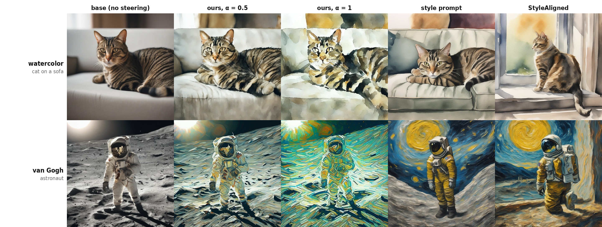

# DBsteer: Direct-Block Steering for Diffusion Style Editing

DBsteer is a training-free style-editing method for text-to-image diffusion
models. It measures the mean difference between styled and neutral transformer
block updates, then injects the resulting single direction throughout denoising.

## Repository structure

The Git repository contains only the project-authored DBsteer source code.
External source code, model weights, checkpoints, generated images, and
benchmark artifacts are intentionally excluded.

```text
2027ICEIC_copyright_source/                 # this Git repository
├── src/dbsteer/
│   ├── prompts.py                           # prompt templates and content splits
│   └── runtime.py                           # capture and injection hooks
├── scripts/
│   ├── extract_direction.py                 # estimate a style direction
│   └── generate_dbsteer.py                  # generate with DBsteer
├── outputs/                                 # created locally; ignored by Git
│   ├── directions/                          # photo.pt and <style>.pt
│   └── generation/                          # base and DBsteer images
├── requirements.txt
├── THIRD_PARTY_NOTICES.md
└── REPRODUCTION_REQUIREMENTS.md
```

The following is the full server workspace used for the original experiments.
It is not part of this Git repository.

```text
/home/ci/bkk/
├── 2027ICEIC/                               # full experimental workspace
│   ├── common/                               # shared experiment helpers
│   ├── sdxl_unbox/
│   │   ├── checkpoints_k10/                  # external SAE checkpoint
│   │   └── checkpoints_k160/                 # external SAE checkpoint
│   ├── third_party/                          # external source code
│   └── experiments/EXP01_style_steer/
│       ├── feats*/                           # extracted experiment statistics
│       ├── imgs/                             # generated images
│       ├── metrics/                          # benchmark metrics
│       └── grids/                            # paper figures
└── 2027ICEIC_copyright_source/              # this clean source repository
```

SDXL model weights and the fp16-fix VAE are downloaded separately through
Hugging Face and are not stored in either repository. DBsteer does not use a
separate training dataset: its direction-estimation data are generated from the
prompt lists in `src/dbsteer/prompts.py`.

## 1. Requirements

The original experiments were run with the following environment:

- Python 3.11.15
- PyTorch 2.5.1+cu124 (CUDA 12.4)
- torchvision 0.20.1+cu124
- diffusers 0.29.2
- transformers 4.46.1
- GPU: NVIDIA A100-PCIE-40GB

Create an environment, install the dependencies, and expose the local source
and separately installed hook-enabled SDXL runtime:

```bash
conda create -n dbsteer python=3.11
conda activate dbsteer

# Install a PyTorch build compatible with the local CUDA driver.
pip install torch torchvision --index-url https://download.pytorch.org/whl/cu124
pip install -r requirements.txt

export PYTHONPATH="$PWD/src:$PYTHONPATH"
export SDXL_UNBOX_PATH=/home/ci/bkk/2027ICEIC/sdxl_unbox
```

`SDXL_UNBOX_PATH` must point to a separately obtained SDXL-Unbox checkout.
Its source and checkpoints are not included in this repository. See
`THIRD_PARTY_NOTICES.md` for external dependencies and licenses.

## 2. Dataset

DBsteer requires no training dataset. Instead, it creates paired generations
for the same content and initial seed:

- **Neutral condition:** a photo-style prompt.
- **Styled condition:** the same content with a target style prompt.

`src/dbsteer/prompts.py` contains 32 direction-estimation contents and 8
held-out contents. The two sets are disjoint. Running the extraction script
creates the only data needed by DBsteer, saved as raw block-update tensors in
`outputs/directions/`.

## 3. Training

DBsteer is training-free. It does not optimize model parameters, train a
network, or create a learned DBsteer checkpoint. This section therefore has no
training command.

For each target style, the method averages the raw update of a selected
transformer block over the styled generations, subtracts the corresponding
neutral average, and uses the difference as a fixed steering direction.

## 4. Testing

DBsteer has no trained method checkpoint. Testing consists of estimating a
style direction from paired prompt conditions and applying that saved direction
to held-out content prompts. Run all commands from the repository root after
setting `PYTHONPATH` and `SDXL_UNBOX_PATH` as shown above.

**Estimate a style direction by**

```bash
python scripts/extract_direction.py \
  --conditions photo watercolor \
  --output-dir outputs/directions \
  --block up.0.1 \
  --steps 30 \
  --batch-size 8
```

The command creates `outputs/directions/photo.pt` and
`outputs/directions/watercolor.pt`.

**Test DBsteer on held-out contents by**

```bash
python scripts/generate_dbsteer.py \
  --style watercolor \
  --direction-dir outputs/directions \
  --output-dir outputs/generation \
  --alpha 0.5 \
  --seed 2000 \
  --steps 30 \
  --batch-size 8 \
  --save-base
```

- `--style`: style whose statistics have been extracted in the first step.
- `--direction-dir`: directory containing `photo.pt` and `<style>.pt`.
- `--output-dir`: directory in which directions and images are saved.
- `--alpha`: injection strength. Smaller values prioritize scene preservation;
  larger values produce a stronger style change.
- `--seed`: first generation seed. The script assigns consecutive seeds to the
  held-out content prompts.
- `--save-base`: additionally saves unsteered images generated with the same
  prompts and seeds.

The testing script generates the eight held-out prompts defined in
`src/dbsteer/prompts.py`. It saves `base_*.png` files when `--save-base` is
enabled and `dbsteer_<style>_*.png` files for the edited outputs.

## 5. Results

All quantitative results use SDXL Base 1.0, 7 styles, 8 held-out contents, and
5 seeds. Values are mean ± standard deviation across seeds.

### Steering methods at matched content change

All methods in this table are evaluated at matched LPIPS 0.35. Higher CSD
indicates stronger style transfer; higher DINOv2 and prompt fidelity indicate
better preservation of the unsteered image and requested content, respectively.

| **Method** | **CSD ↑** | **DINOv2 to base ↑** | **Prompt fidelity ↑** |
| --- | ---: | ---: | ---: |
| **DBsteer** | **0.486 ± 0.028** | 0.785 ± 0.008 | 0.264 ± 0.003 |
| signed | 0.428 ± 0.017 | 0.782 ± 0.008 | 0.262 ± 0.003 |
| dmsae (K=128) | 0.408 ± 0.022 | 0.791 ± 0.010 | 0.265 ± 0.003 |
| dmsae (K=32) | 0.402 ± 0.017 | 0.791 ± 0.013 | 0.265 ± 0.003 |
| louvre | 0.353 ± 0.017 | 0.816 ± 0.011 | 0.262 ± 0.003 |
| uniform | 0.352 ± 0.013 | **0.818 ± 0.009** | 0.263 ± 0.004 |
| clamp | 0.352 ± 0.014 | 0.800 ± 0.007 | 0.263 ± 0.003 |
| unbox | 0.348 ± 0.013 | 0.816 ± 0.012 | 0.264 ± 0.003 |

### Prompt-based references

Style prompting and StyleAligned operate at their native strengths rather than
LPIPS 0.35, so their style scores are not directly comparable with the matched
steering results above.

| **Method** | **LPIPS ↓** | **CSD ↑** | **DINOv2 to base ↑** | **Prompt fidelity ↑** |
| --- | ---: | ---: | ---: | ---: |
| style prompt | 0.561 ± 0.018 | 0.717 ± 0.013 | 0.571 ± 0.013 | 0.255 ± 0.002 |
| StyleAligned | 0.613 ± 0.014 | 0.754 ± 0.018 | 0.423 ± 0.020 | 0.231 ± 0.006 |

### Qualitative examples



Two held-out content/style pairs are shown. The first three columns show the
unsteered base image and DBsteer at two injection strengths. The final two
columns are prompt-based references. DBsteer changes surface appearance while
preserving the requested scene more directly than prompt-based generation.

The metric computation, external baseline implementations, and full benchmark
artifacts remain in the experimental workspace at
`/home/ci/bkk/2027ICEIC/experiments/EXP01_style_steer/` and are not included as
source code in this repository.

## Scope and provenance

This repository is prepared to identify the project-authored DBsteer source
code for copyright-registration review. It makes no ownership claim over
external dependencies, model weights, checkpoints, metrics, or baseline
methods.
